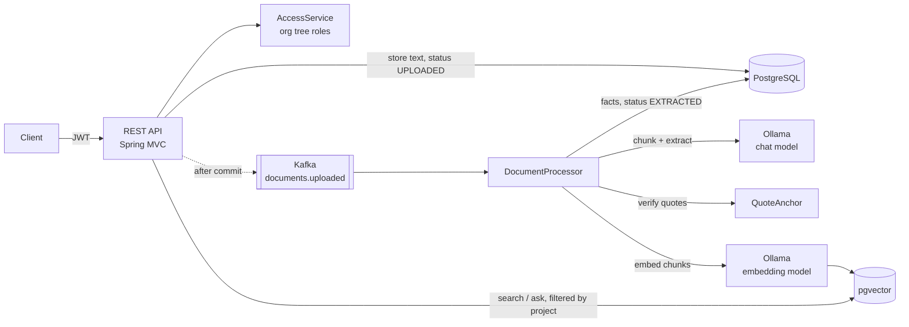

# Document Intelligence Service

[](https://github.com/snipperxx/document-intelligence-service/actions/workflows/ci.yml)


A Spring Boot backend that turns uploaded documents into **source-anchored facts** and a
**permission-aware semantic search index**, using a local LLM through Ollama.

Teams upload contracts, reports or notes into projects. The service extracts
subject–predicate–object facts asynchronously, **rejects every fact whose quote cannot be found
in the source text**, and answers questions with citations. Only documents the caller is allowed
to see are ever retrieved.

## Features

- **Hierarchical access control.** Organization → department → project tree. A role (VIEWER,
  EDITOR, ADMIN) granted on a unit applies to its whole subtree, resolved through a materialized
  path in a single indexed query.
- **Asynchronous processing with Kafka.** Upload returns `202 Accepted`. A consumer chunks the
  text, calls the LLM and indexes embeddings. Processing is idempotent and survives redelivery.
- **Hallucination guard.** The model must quote its evidence. Each quote is located in the source
  (exact, then whitespace/case/typography tolerant). Facts without a match are dropped and counted.
- **Semantic search and RAG answers** over pgvector. The project filter is applied *inside* the
  vector query, so results never leak across teams and top-k is never wasted on denied chunks.
- **Production basics.** JWT (OAuth2 resource server), RFC 9457 problem responses, Flyway
  migrations, OpenAPI/Swagger UI, Actuator probes, Prometheus metrics, Docker, Kubernetes manifests.
- **59 tests, 95% instruction coverage.** Integration tests run against real PostgreSQL and Kafka via
  Testcontainers; only the models are replaced by deterministic fakes.

## Architecture



**Upload flow**

1. `POST /api/projects/{id}/documents`: the caller needs EDITOR on the project. Text is extracted
   (TXT, Markdown, PDF via PDFBox), normalized and stored with status `UPLOADED`.
2. After the transaction commits, the document id is published to Kafka, keyed by document id.
3. The consumer atomically claims the document (`UPLOADED → PROCESSING`). If the claim affects 0
   rows, the message is a duplicate and is skipped.
4. The text is split into overlapping chunks. For each chunk, the LLM proposes facts as structured
   JSON. Each quote is anchored to character offsets in the original document, and unverifiable
   facts are rejected.
5. Chunks are embedded into pgvector with deterministic row ids. Facts are written and the
   document becomes `EXTRACTED`, or `FAILED` with a reason.

## Design decisions

| Decision | Why | Trade-off |
|---|---|---|
| Materialized path (`/1/4/9/`) for the org tree | Ancestor lookup is a split of the path; "all projects below my units" is one `LIKE 'prefix%'` query on an indexed column | Moving a subtree means rewriting paths (not supported yet) |
| 404 instead of 403 for units you have no role on | Does not reveal that other teams' units or documents exist | Slightly less helpful error for legitimate typos |
| Publish to Kafka in `@TransactionalEventListener(AFTER_COMMIT)` | A consumer can never see an id that is not committed yet | If the broker is down right after commit, the event is lost; the document stays `UPLOADED` and the reprocess endpoint re-sends it. A transactional outbox would close the gap |
| Thin events (id only) | The consumer always reads current state, so stale or reordered messages cannot overwrite newer data | One extra DB read per message |
| Atomic claim via conditional `UPDATE … WHERE status = 'UPLOADED'` | Idempotent under at-least-once delivery and multiple consumers, without distributed locks | A crashed worker leaves `PROCESSING`; such claims count as abandoned after 30 min and can be reprocessed |
| LLM calls outside DB transactions (`TransactionTemplate` around claim and final write only) | Generation takes seconds to minutes; holding a connection and row locks that long would exhaust the pool | Intermediate state is not visible until the final write |
| `max-poll-records=1`, long `max.poll.interval.ms` | Slow LLM work must not get the consumer kicked from its group mid-batch | Lower throughput per consumer; scale with partitions and replicas |
| Explicit HTTP timeouts and 3 AI retries | Spring AI's defaults (10 attempts, backoff up to 3 min, no connect timeout) can park a document for 20+ min when Ollama is down | A slow model needs a read timeout above its generation time (5 min configured) |
| Store the matched source span, not the model's quote | Stored quotes are always verbatim, even when the model changed case or whitespace | — |
| Flyway owns the pgvector table | Vector schema is versioned and reviewed like every other table | Changing embedding dimensions needs a migration |

## API

Interactive documentation: <http://localhost:8080/swagger-ui.html>

| Method | Path | Role | Description |
|---|---|---|---|
| POST | `/api/auth/register` | – | Create an account |
| POST | `/api/auth/login` | – | Get a JWT |
| GET | `/api/auth/me` | any | Current user |
| POST | `/api/organizations` | any | Create an organization (caller becomes ADMIN) |
| POST | `/api/units/{id}/children` | ADMIN | Create a department or project |
| GET | `/api/units/mine` | any | Units with a direct role |
| GET | `/api/units/{id}` · `/children` · `/members` | VIEWER | Read the tree and members |
| PUT | `/api/units/{id}/members` | ADMIN | Grant or change a role |
| POST | `/api/projects/{id}/documents` | EDITOR | Upload `.txt`, `.md` or `.pdf` (multipart, max 10 MB) |
| GET | `/api/projects/{id}/documents` | VIEWER | List documents (paged) |
| GET | `/api/documents/{id}` · `/content` · `/facts` | VIEWER | Status, text, anchored facts |
| POST | `/api/documents/{id}/reprocess` | EDITOR | Re-run extraction |
| DELETE | `/api/documents/{id}` | EDITOR | Delete document, facts and vectors |
| GET | `/api/search?q=…&topK=…` | any | Semantic search over visible projects |
| POST | `/api/ask` | any | RAG answer with numbered citations |

## Running locally

Requirements: Docker, and [Ollama](https://ollama.com) on the host.

```bash
ollama pull qwen3.5:4b          # chat model used for extraction and answers
ollama pull nomic-embed-text    # 768-dimension embedding model
docker compose up --build
```

The API is on <http://localhost:8080>. To develop from an IDE, start only the infrastructure with
`docker compose up -d postgres kafka` and run `DocumentIntelligenceApplication`.

A short session:

```bash
curl -X POST localhost:8080/api/auth/register -H 'Content-Type: application/json' \
  -d '{"email":"alice@example.com","displayName":"Alice","password":"a-long-password"}'
TOKEN=$(curl -s -X POST localhost:8080/api/auth/login -H 'Content-Type: application/json' \
  -d '{"email":"alice@example.com","password":"a-long-password"}' | jq -r .accessToken)

curl -X POST localhost:8080/api/organizations -H "Authorization: Bearer $TOKEN" \
  -H 'Content-Type: application/json' -d '{"name":"Acme"}'                         # id 1
curl -X POST localhost:8080/api/units/1/children -H "Authorization: Bearer $TOKEN" \
  -H 'Content-Type: application/json' -d '{"name":"Legal","type":"DEPARTMENT"}'    # id 2
curl -X POST localhost:8080/api/units/2/children -H "Authorization: Bearer $TOKEN" \
  -H 'Content-Type: application/json' -d '{"name":"Contracts","type":"PROJECT"}'   # id 3

curl -X POST localhost:8080/api/projects/3/documents -H "Authorization: Bearer $TOKEN" -F file=@contract.pdf
curl -X POST localhost:8080/api/ask -H "Authorization: Bearer $TOKEN" \
  -H 'Content-Type: application/json' -d '{"question":"When is payment due?"}'
```

### Configuration

| Variable | Default | Purpose |
|---|---|---|
| `DB_URL`, `DB_USER`, `DB_PASSWORD` | local `docintel` database | PostgreSQL with the `vector` extension |
| `KAFKA_BOOTSTRAP_SERVERS` | `localhost:9092` | Kafka brokers |
| `OLLAMA_BASE_URL` | `http://localhost:11434` | Ollama endpoint |
| `OLLAMA_CHAT_MODEL` | `qwen3.5:4b` | Model for extraction and answers |
| `OLLAMA_EMBEDDING_MODEL` | `nomic-embed-text` | Must produce 768-dimension vectors (see `V2__vector_store.sql`) |
| `JWT_SECRET` | development key | Base64 HMAC key, at least 32 bytes. **Set in production** |

## Tests

```bash
./mvnw verify
```

- **Unit tests**: quote anchoring, chunking, text extraction, hierarchy rules, document lifecycle,
  and the LLM structured-output parsing against a scripted model.
- **Integration tests** (`*IntegrationTest`): the full HTTP → PostgreSQL → Kafka → pgvector path
  with Testcontainers. They cover authentication, role inheritance and isolation between sibling
  departments, asynchronous extraction, hallucination rejection, idempotent redelivery,
  reprocessing, failure handling, permission-filtered search and RAG answers.

The coverage report is written to `target/site/jacoco/index.html`.

## Deployment

`k8s/` contains a Kustomize base: Deployment with startup/liveness/readiness probes on the Actuator
endpoints, a non-root read-only container, a Service and a ConfigMap. Secrets are created
separately (`k8s/secret.example.yaml`). PostgreSQL, Kafka and Ollama are expected as managed or
separately deployed services.

```bash
kubectl apply -k k8s
```

## Project layout

```
src/main/java/io/github/snipperxx/docintel/
├── auth/        registration, login, JWT issuing
├── org/         organization tree, memberships, hierarchical AccessService
├── document/    upload, text extraction, document lifecycle, Kafka relay
├── extraction/  Kafka consumer, chunking, LLM extraction, quote anchoring
├── search/      pgvector index, semantic search, RAG answers
├── config/      security, Kafka topic, OpenAPI, typed properties
└── common/      error handling, paging
```

## Limitations and next steps

- Transactional outbox instead of after-commit publishing.
- Dead-letter topic and automatic retries with backoff for transient model failures.
- Moving units within the tree (path rewrite), and removing memberships.
- Streaming answers (Server-Sent Events) for `/api/ask`.
- Refresh tokens and rate limiting on login.
